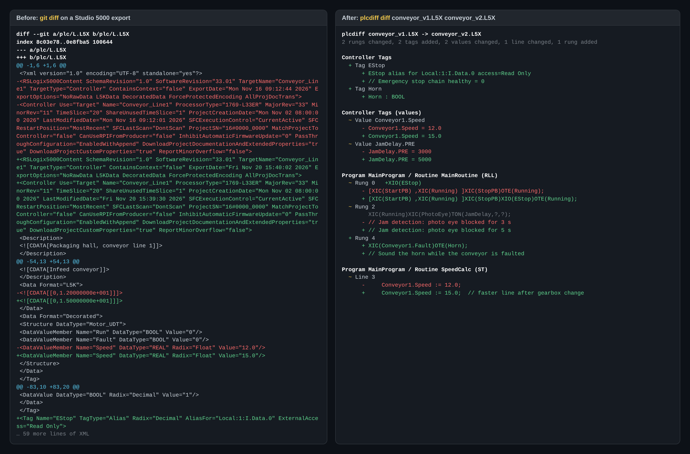

# plcdiff

[](https://pypi.org/project/plcdiff/)
[](https://github.com/DanShinde/plcdiff/actions/workflows/ci.yml)
[](https://pypi.org/project/plcdiff/)
[](LICENSE)

**Readable git diffs for PLC program exports.** Rockwell Studio 5000 `.L5X`, Siemens TIA Portal
SimaticML and PLCopen XML (CODESYS, TwinCAT, Beremiz, Machine Expert, ...) shown rung by rung, tag by tag, line by line,
instead of as a wall of XML.



PLC teams are moving their projects into git, but an export changes in a hundred places when
someone edits one rung: export timestamps, reflowed attributes, CDATA blocks, layout
coordinates. `plcdiff` turns the export into a stable, line-oriented view and compares *that*,
so a review shows what an engineer actually changed:

- **Rungs** compared as ladder text, with the instructions that were added or removed
  (`~ Rung 0  +XIO(EStop)`). Inserting a rung does not renumber every rung below it.
- **Structured Text** compared line by line, indentation kept.
- **Tags, UDT members, AOI parameters, POU variables** compared by name, so reordering is
  not a change, plus **tag values** (timer presets, setpoints, recipe arrays) flattened to
  `JamDelay.PRE = 5000`.
- **Comments and descriptions** diffed separately from the logic.
- **Layout noise ignored**: export dates, LD/FBD box positions, hidden UDT backing members.

Pure Python standard library, no dependencies. Python 3.10+ on Linux, Windows and macOS.

## Install

```console
pip install plcdiff        # or: pipx install plcdiff / uv tool install plcdiff
```

## Use it with git (one-time setup)

Inside your PLC repository:

```console
$ plcdiff install
git config diff.plcdiff.textconv "plcdiff textconv"
added to /work/line1/.gitattributes: *.L5X diff=plcdiff; *.l5x diff=plcdiff
Done. `git diff` and `git log -p` now show PLC exports rung by rung.
```

From then on `git diff`, `git log -p`, `git show` and GUI clients that honour textconv show the
readable view. Commit `.gitattributes` so the whole team gets the mapping (each person runs
`plcdiff install` once, or `plcdiff install --global` for every repository).

PLCopen and TIA Portal (SimaticML) exports usually end in `.xml`, so map them explicitly:

```console
plcdiff install --pattern "plc/*.xml"
```

Files that are not PLC exports pass through untouched, so a broad pattern never breaks a diff.

## Semantic diff of two files

```console
plcdiff diff Line1_old.L5X Line1_new.L5X
plcdiff diff old.xml new.xml --format markdown   # for a pull request comment
plcdiff diff old.xml new.xml --format json       # for scripts
plcdiff diff a.L5X b.L5X --no-values --exit-code # ignore tag values; exit 1 on changes
```

Works as a git difftool too: `git difftool -y -x "plcdiff diff" HEAD~1 -- Line1.L5X`.

## Everything that changed in a commit range

```console
plcdiff git                    # working tree vs HEAD
plcdiff git main..feature      # between two revisions (renames followed)
plcdiff git v1.4 plc/          # since a tag, limited to a folder
```

## GitHub Action

Put a rung-by-rung summary of every PLC change into the job summary of each pull request:

```yaml
on: pull_request
jobs:
  plcdiff:
    runs-on: ubuntu-latest
    steps:
      - uses: actions/checkout@v4
        with:
          fetch-depth: 0
      - uses: DanShinde/plcdiff@v0.1.0
        id: plcdiff
      # Optional: post it as a PR comment
      - if: steps.plcdiff.outputs.changed == 'true'
        run: gh pr comment ${{ github.event.number }} --body-file ${{ steps.plcdiff.outputs.report }}
        env:
          GH_TOKEN: ${{ github.token }}
```

Inputs: `base`, `head`, `paths`, `no-values`, `working-directory`, `python-version`.
Outputs: `changed` (`"true"`/`"false"`) and `report` (path of the Markdown file).

## What is covered

| Format | Covered |
| --- | --- |
| Rockwell `.L5X` (Studio 5000 / RSLogix 5000), full project or partial export | controller properties, UDTs, modules (catalog, revision, IP address, inhibit), AOIs (parameters, local tags, routines), controller and program tags with values, aliases, produced/consumed, programs, tasks, ladder (RLL) rungs and comments, Structured Text; FBD and SFC routines as one line per element; source-protected routines reported as such |
| Siemens TIA Portal SimaticML (`.xml` from Openness or an export add-in, one block per file) | OB, FB, FC, global and instance DBs, PLC data types (UDTs), PLC tag tables with user constants; block attributes, interface members with comments and start values; LAD and FBD networks decoded into one statement per coil, box or call (`#Run := (#Start OR #Run) AND NOT #Stop`), SCL line by line; network titles and comments kept apart from the logic. Export noise (TIA version, export time, `ID`/`UId` numbering, compile dates) is ignored |
| PLCopen TC6 XML (`tc6_0200`, `tc6_0201`) | data types (struct, enum, array, subrange, pointer, string), POU interfaces with initial values, ST and IL bodies, actions, transitions, CODESYS methods and global variable lists, configurations, resources, tasks, global variables; LD, FBD and SFC as one line per element with layout removed |

Known limits in this release, all good first contributions:

- PLCopen LD/FBD **wiring** (which contact connects to which coil) is not compared yet, only
  the elements and their variables. (TIA Portal LAD/FBD networks are decoded with their wiring.)
- Rockwell `.L5K` and TIA Portal GRAPH, STL and plain `.scl` source files are not supported yet.
- The sample exports in `examples/` are hand-written to match the published schemas. Real-world
  exports vary between versions; if something parses oddly, please open an issue with a
  (sanitized) file.

## Python API

```python
from plcdiff import load, diff_documents, render

old, new = load("v1.L5X"), load("v2.L5X")
for block in diff_documents(old, new):
    for change in block.changes:
        print(block.title, change.op, change.name)

print(render(new))  # the textconv view
```

## Related tools

`plcdiff` is part of a small set of open-source tools for automation engineers:

- [fakeplc](https://github.com/DanShinde/fakeplc): a fake PLC (OPC UA + Modbus TCP) for tests and demos
- [tagscope](https://github.com/DanShinde/tagscope): log OPC UA tags to a database, with a dashboard
- [tagbridge](https://github.com/DanShinde/tagbridge): Modbus / OPC UA to MQTT Sparkplug B gateway

## Contributing

Issues and pull requests are welcome, see [CONTRIBUTING.md](CONTRIBUTING.md).

Not affiliated with Rockwell Automation, Siemens or PLCopen. Studio 5000 and RSLogix are
trademarks of Rockwell Automation, Inc. TIA Portal and SIMATIC are trademarks of Siemens AG.

## License

MIT
